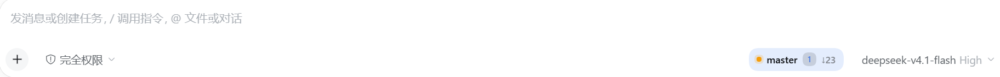
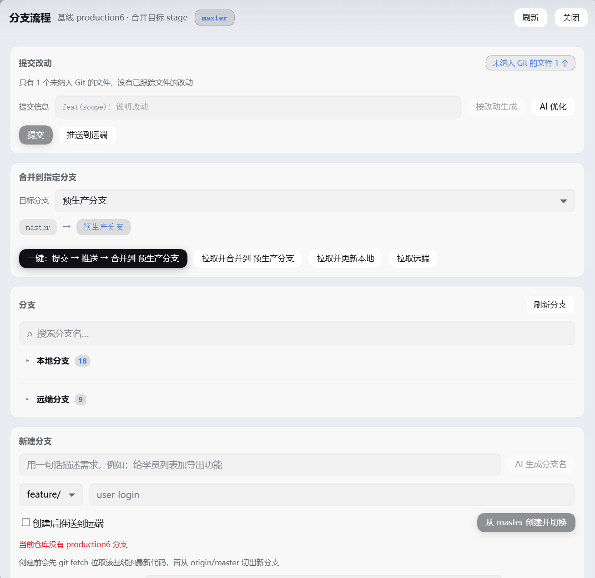

# dsh-branch-flow

**English** | [简体中文](README.zh-CN.md)

[](LICENSE)
[](https://github.com/crystal-hang/dsh-branch-flow)
[](https://github.com/crystal-hang/dsh-branch-flow/tags)
[](package.json)
[](#installation)

A branch-flow panel for the DSH Web GUI. A status chip sits inside the composer; click it to open the full branch / commit / merge panel.

It removes the mechanical loop after editing code — staging, writing a commit message, switching branches, pulling, merging, pushing — and validates branch names and commit messages against your team's conventions as you type.

## Screenshots

The branch chip in the composer. Click it to open the panel:



The full panel — commit changes, merge into a target branch, branch list, create branch:



While a merge is conflicted the chip turns red and shows the conflict count:


## Installation

This is a DSH profile bundle. Replace `<profile>` below with your profile name (usually `desktop`) and pick any of the four methods:

```sh
# 1) From GitHub (recommended, version-pinnable)
dsh plugin --profile <profile> add github:crystal-hang/dsh-branch-flow#v0.1.0

# 2) From GitHub, latest main
dsh plugin --profile <profile> add github:crystal-hang/dsh-branch-flow

# 3) From a local directory (development / personal use)
dsh plugin --profile <profile> add link:/path/to/dsh-branch-flow

# 4) From npm (if published)
dsh plugin --profile <profile> add dsh-branch-flow
```

You can also hand the whole directory to `plugin_manager`'s `install_bundle` (pass the absolute path as `target`).

> Installing with a tag such as `#v0.1.0` makes `npm install` check out that tag's commit, so the version is reproducible. Omitting the tag follows the latest commit on `main`, which suits tracking development.

**Reload the page** after installing. The chip appears inside the composer, immediately left of the model selector.

### Version

The current version is in the `version` field of [`package.json`](package.json) and in [Releases](https://github.com/crystal-hang/dsh-branch-flow/releases). To upgrade, replace the tag above with the new version number.

### Requirements

- DSH `>=0.2.1-rc.2` (`dsh.engines.dsh`)
- The host must provide the `webServer`, `subprocess`, and `workspaceRegistry` services
- AI features (branch-name and commit-message generation) need the host to compose `llm` and `agentDefaultModel`; when either is missing the panel reports an explicit error instead of failing silently

## Interface

- **Status chip** (inside the composer, immediately left of the model selector): branch name + status dot (green = clean, yellow = changes, red = conflicts) + change count + `↑`/`↓` ahead/behind. Click it to open the panel. The row above the composer stays free.
- **Panel**: commit changes → push branch → merge into a target branch (headings carry no numbering), plus the branch list and branch creation. Every action is button-driven; the plugin registers no model-facing tools.
- **The branch list has two collapsible groups**:
  - **Local branches** (expanded by default): switch / delete.
  - **Remote branches** (**collapsed by default**): branches a colleague pushed that you have not created locally yet (present in `origin/*`, absent from `refs/heads`). An active repository may carry hundreds, hence collapsed; clicking "switch" creates the local tracking branch (`git switch -c <name> --track origin/<name>`).
  - Each group carries its own count badge (the heading shows only the group name and count, with no extra description).
- **Branch search**: one box filters both groups (case-insensitive substring match) with a one-click clear. While searching, both groups stay expandable; even a collapsed group's count badge shows its match count so you know to expand it.
- **Refresh branches**: a title-bar button that runs `git fetch --prune` and re-reads, so a branch a colleague just pushed appears immediately.
- Each branch row shows only the **branch name + tags + relative time** (no commit hash).
- **Commit changes lists only files already tracked by Git** (modified / added / deleted / renamed). Untracked files are hidden by default — a real workspace accumulates `AGENTS.md`, `__pycache__/*.pyc`, and build output that never entered Git. The card's top-right corner shows "N files not in Git"; click it to expand when you do want to commit a new file.

The chip mounts at `conversation.input.right`, which the host renders before `conversation.input.model`, so it sits left of the model selector at the same row's button height (28px).

The chip width **adapts to its content** (`flex: 0 1 auto`, no fixed width), capped at `min(45vw, 420px)` — 420px fits the 50-character branch names the rules allow, and 45vw keeps it inside narrow windows. It truncates only when it genuinely does not fit, and hovering reveals the full branch name.

Styles reference only host theme variables (`--dsw-*`), so light and dark themes follow automatically.

## Visual design

Controls share one grammar: **pill geometry + tinted brand fill + deeper fill on hover** (no longer just a border colour change).

- **Buttons**: 28px tall, fully rounded, 1px stroke, brand colour at 8% fill; on hover the stroke and fill deepen and a 1px shadow lifts the button, with a 0.5px offset while pressed.
- **Primary buttons** (commit / one-click / merge / create): the only saturated surface — a vertical brand gradient, transparent border, and brand-tinted shadow; hover deepens it and widens the glow.
- **Danger buttons** (delete / abort merge): a faint red stroke and fill that intensify only on hover — they perform destructive actions and should not compete for attention at rest.
- **Status chip**: a pill with a brand-tinted fill; the status dot is green/yellow/red with a matching soft glow.
- **Inputs / selects / search fields (iOS style)**: native chrome removed (`appearance:none`), replaced with a **filled, borderless** surface — neutral fill at 6%, 10px radius, subtle inner shadow. On focus the fill becomes solid and a 4px translucent brand ring grows outward instead of a thicker border. Selects use a CSS-drawn chevron (native arrow removed) with 30px of reserved space.
- **Panel / cards**: the panel has a 20px radius, deep shadow, and inner stroke; cards use a 16px radius with no hard border, layered by a neutral fill at 3% and a 1px inner stroke.
- **Notices**: success / warning / error each carry their own tinted fill and stroke.

The font stack is the system stack throughout (`-apple-system, BlinkMacSystemFont, ui-sans-serif, system-ui`) — half of the iOS feel comes from pairing this geometry with system type rather than looking like a web control.

Every colour is derived from **theme tokens** via `color-mix()` (for example `color-mix(in srgb, var(--dsw-alias-brand-primary) 8%, var(--dsw-alias-bg-layer-2))`); no light or dark palette is hard-coded, so each theme computes its own suitable ramp. Under `prefers-reduced-motion`, all animation and offset is disabled.

## Branch rules (enforced on creation)

1. Lowercase only, words joined by `-`; no underscores, camelCase, or spaces.
2. Only English letters, digits, `-`, and `/`; no Chinese characters or special symbols.
3. A single name stays under 50 characters.
4. No self-invented environment names beyond `production6` and `stage` (`prod`, `test`, `uat`, `release2`, `dev2`, … are refused).
5. The name must express an environment or a purpose; `test1`, `aaa`, `tmp`, `new` and the like are rejected.
6. Always use a hierarchy prefix: `feature/`, `bugfix/`, `hotfix/`, `release/`, followed by a short English description.

**Unified baseline**: new branches are cut from the latest `production6` only, and the panel refuses to cut from `stage` (`error.stage-baseline`). It runs `fetch --prune` first, then branches from `origin/production6`.

> If a repository has no `production6` at all (say a legacy repository using `master`), the panel does not pretend it can create a branch: it states plainly that this repository lacks production6 and offers a searchable list of **every** branch in the repository (with a "showing N / M" count). Your chosen baseline is remembered per repository (`localStorage`). A baseline is an existing ref, so the new-branch naming rules do not apply to it — historical names like `预生产分支` work as a baseline.

**Creating a branch pulls the latest code first**: it runs `git fetch --prune`, then cuts and checks out from `origin/<baseline>` (preferring the remote when it exists, otherwise the local baseline), so a new branch is never behind.

**AI branch names**: in the create card, describe the work in one line (for example "add export to the student list") and press "AI suggest name" or simply Enter. The plugin calls your default model to translate it into a conforming branch name such as `feature/student-list-export`. The result fills the prefix and description fields and **remains editable**; you confirm before anything is created.

Every suggestion passes the rule check:

- Markdown fences, quotes, a `git switch -c` prefix, uppercase, and underscores are all cleaned up;
- A prefix outside the allowlist (such as `feat/` or `perf/`) is rewritten to `feature/`, with the notice "prefix corrected to the convention";
- The prefix you selected in the form wins — a different one from the model is rewritten back;
- Chinese text, plain prose, and meaningless names like `feature/test` are rejected with a reason.

**Push after creating**: the create card carries a "Push to remote after creating" checkbox (on by default). When checked it runs `git switch -c <name> <baseline>` followed by `git push --set-upstream origin <name>`, so the branch is immediately available on the remote. A failed push does not undo the local branch; the reason is reported separately.

## Commit message convention

`<type>(<scope>): <subject>`, where type is limited to
`feat` `fix` `refactor` `perf` `docs` `style` `test` `build` `ci` `chore` `revert`.

The panel validates input live and auto-corrects fixable deviations:

- Full-width `（）：` become half-width;
- Chinese types (新增 / 修复 / 重构 / 优化 / 文档 …) map to the matching type;
- A missing `type(scope):` prefix is filled in from the branch prefix (`feature/`→`feat`, `bugfix/`→`fix`, `hotfix/`→`fix`, `release/`→`chore`);
- Scope keeps only letters, digits, and `_ . -`; when empty it is inferred from the changed files' directories;
- A trailing period is dropped, newlines are flattened, and an over-long subject is flagged.

Messages come from two sources, and both must conform before committing:

- **From the diff**: entirely local, zero calls — assembles a conforming draft from the branch purpose plus the changed directories;
- **AI polish**: calls the default provider/model you selected in settings (the host `llm` service) to rewrite it, then runs the result through the same rule check and shows both the raw output and the corrected result.

## One-click flow

The panel no longer lists step-by-step copy (the button label already says "commit → push → merge"). The behaviour is:

1. Stage and commit the checked files (skip the commit when the worktree is clean);
2. Push the current branch (setting the upstream automatically when there is none);
3. Fetch the latest → switch to the target branch → fast-forward to the remote → merge this branch → push the target branch → switch back to the branch you were on.

Underneath: `git add` → `git commit -m <conforming message>` → `git push [--set-upstream]` → `git fetch --prune` → `git switch <target>` → `git merge --ff-only origin/<target>` → `git merge <source>` → `git push <target>` → `git switch <original>`.

The merge fast-forwards when it can, otherwise it creates a merge commit (no forced `--no-ff`).

`production6` serves as a baseline only: selecting it as a target is refused (`error.production-protected`), and the panel offers no way to delete it.

## Fetch vs pull

These two buttons are not the same thing, and the panel keeps them separate:

- **Fetch remote** (`git fetch --prune`): updates only the remote-tracking refs under `origin/*` and **touches neither your local branches nor your working files**. It therefore often looks like it "did nothing" — the code really is still old. The panel surfaces the result: "the remote has new commits: xxx is N behind and M ahead, click 'Pull and update local' to bring the code down".
- **Pull and update local** (fetch + `git merge --ff-only`): fast-forwards your local branch onto the remote, which is what actually changes your code. It refuses when the branches have diverged (`error.diverged`) rather than quietly rewriting history, and refuses when tracked files carry uncommitted changes.

## Preconditions for switching and merging

**Untracked files block nothing.** Files that never entered Git — `AGENTS.md`, `__pycache__/*.pyc`, build output — are carried across a branch switch by git as-is. Refusing on them as "uncommitted changes" would leave a workspace holding only caches and scratch notes permanently unable to switch or merge.

**Switching branches imposes no "clean worktree" gate**, leaving the decision to git:

- Changes that do not conflict with the target → the switch happens and the changes come along;
- Changes that would overwrite the target → git refuses, and the plugin maps this to `tracked-changes-would-be-overwritten`, listing the blocking paths.

**Merging requires tracked files to have no uncommitted changes** (a merge moves HEAD, and merging with half-finished work is error-prone); the error names the file count. Existing conflicts or an in-progress Git operation are blocked first.

## Conflicts

A merge conflict is **not rolled back**; the repository stays mid-merge, the panel lists the conflicting files and offers three actions:

- **Send the fix request to the composer**: writes the conflict file list and repair instructions into the current session's composer (through the host-provided `inputActions.insertText`); press Enter to let the model edit;
- **Conflicts resolved, finish the merge**: `git add -A` + `git commit --no-edit` completes the merge (refused while conflict markers remain);
- **Abort merge**: `git merge --abort`.

## Security boundary

**It collects and uploads nothing.** The only remote access is `git fetch` / `git push` against the `origin` you configured. There is no telemetry, no usage reporting, and no external HTTP request (the only `fetch` is the browser calling back to the local host at the relative path `branch-flow/*`).

**What it can do** (the permission surface a code audit should look at):

| Capability | Scope |
|---|---|
| Spawning processes | Runs `git` only, passing an `argv` array to `spawn` — **no shell**, so there is no command injection |
| Reading files | Only `existsSync` to test whether an operation marker in the git directory (`MERGE_HEAD` and friends) exists |
| Writing files | **None.** The plugin writes no files; git writes the repository itself |
| Network | `git fetch`/`push` against `origin` only; no third-party services |
| Runtime dependencies | **Zero npm dependencies**: the host half uses only `node:fs`/`node:path`, the browser half only `require('react')` (host-provided) |

**Access fences** (all covered by regression tests):

- The host `/branch-flow/*` accepts only paths of **registered workspaces** (exact `realpath` comparison); the browser cannot make the host run git against arbitrary directories;
- Loopback access only; requests carrying `X-Forwarded-For` / `CF-Connecting-IP` are refused outright; `content-type: application/json` is required (which blocks cross-site forms);
- **A branch name cannot become a git option**: ref names starting with `-` or containing control characters are refused (`invalid-ref-name`), ruling out parameter injection such as `-D` or `--upload-pack=…`;
- Commit messages and branch names are validated on **both the client and the host**, with the host authoritative;
- The plugin registers no model-facing tools, so the model cannot commit or push on its own; AI is invoked only **when you click a button**, and only branch-name/commit-message drafts or a requirement description are sent;
- Refreshing relies on window focus plus visible-tab polling (panel 10s, chip 30s); a hidden tab spawns no git processes, and no SSE connection is held open.

**About your repository contents**: the plugin neither knows nor reads your source. It runs git commands and sends the panel **result summaries** (branch names, file paths, commit messages, relative times). The one case that sends content to a model is "AI polish" for a commit message, which sends a fragment of the staged diff (truncated to 12 KB) — it does not happen unless you press that button.

## Caveats

Worth knowing before you use it:

1. **It runs with your privileges.** Installing a plugin means allowing that code to execute git commands on your machine. This plugin confines itself to running git against registered workspaces, with regression tests covering that, but it is still a program holding your account's permissions — as with any DSH plugin, trust the source before installing.

2. **`git push` really changes the remote.** Both "one-click" and "push" push to your configured `origin`, and "merge" pushes the target branch on success. **Verify in a test repository first**, confirming the branch name, merge direction, and push target behave as expected before using it on a real repository. `production6` is protected as a baseline (it cannot be a merge target and cannot be deleted), but pushes to targets such as `stage` are real.

3. **AI features send content to your model provider.** "AI polish" (commit message) sends a staged diff fragment (up to 12 KB) to your configured default model; "AI suggest name" sends only the requirement description you typed, no code. If a diff contains secrets, tokens, or internal addresses, use "From the diff" (pure local assembly) or write the message by hand.

4. **The licence is MIT.** You may use, modify, and redistribute it freely, including commercially; the author provides no warranty for the consequences of use. If you redistribute it, keep the copyright notice in the `LICENSE` file.

## Configuration

Override in the profile's `cordis.patch.yml` (every field is optional; defaults shown):

```yaml
- id: branch-flow
  name: dsh-branch-flow
  config:
    baseline: production6   # unified baseline
    target: stage           # default merge target (changeable in the panel)
    remote: origin
    pushAfterMerge: true    # push the target branch after a successful merge
```

## Layout

```
index.js                 Host entry: reads config, wires routes
lib/rules.js             Branch-name / commit-message rules (authoritative host implementation)
lib/git.js               Real git semantics: view / commit / push / merge / conflicts / create branch
lib/routes.js            /branch-flow/* routes + workspace trust fence
lib/message.js           AI commit messages (host llm service)
lib/branch-name.js       AI branch names (host llm service) + reply normalisation
lib/loopback.js          Loopback + same-origin fence
client.js                Browser half: chip and panel (single-file bundle)
locale/{zh,en}.json      Title and description for the plugin manager
icon.svg                 Plugin icon
scripts/verify-git.mjs   Exercises every git verb in a real temporary repository
scripts/verify-client.mjs Renders the chip and panel with a minimal React driver
scripts/verify-css.mjs   Checks stylesheet balance and control geometry
scripts/verify-hooks.mjs Checks components for hook-order mistakes
scripts/verify-branch-name.mjs Checks AI branch-name normalisation and rejection rules
scripts/probe-view.mjs   Read-only dump of one repository's panel view
```

## Self-check

```sh
node scripts/verify-git.mjs         # create repo, commit, push, merge, conflict, protected branch, untracked files, create+push
node scripts/verify-client.mjs      # render chip / panel, conflict state, missing-baseline fallback, alignment variables
node scripts/verify-css.mjs         # CSS rule balance, button/input/select style contract
node scripts/verify-hooks.mjs       # no hook invoked after an early return inside a component
node scripts/verify-branch-name.mjs # AI branch-name cleanup, prefix correction, rejection rules
```

All five scripts report their result through the exit code.
